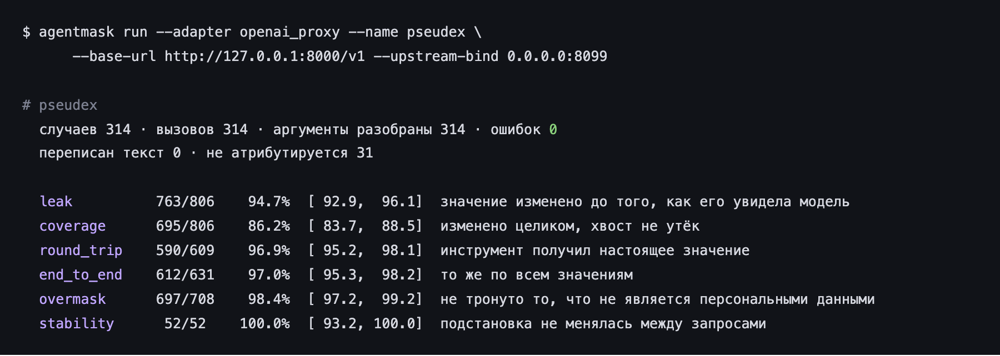
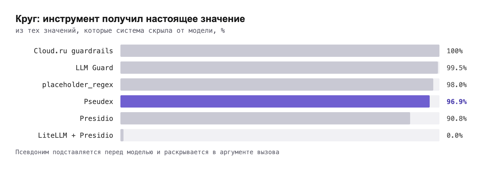
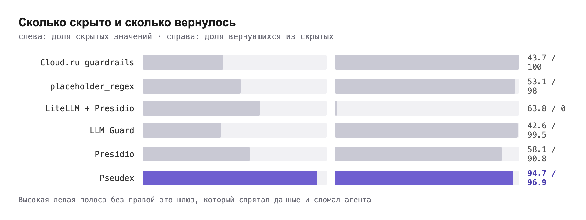

# Маскирование ПДн для LLM: метрика, которую не считает никто, и шесть шлюзов против живого агента

*Это первая статья серии: измеряем, что происходит с LLM-агентом, когда шлюз замаскировал данные. Дальше разберём находки по чужим системам и то, что нашлось у нас.*


## 1. Зачем это вообще мерить

Агент поддержки получает: «Здравствуйте, я Кузнецова Дарья, телефон 8 935 747 66 22, проверьте заказ». Шлюз маскирования делает то, за что ему платят, и до модели доходит «я <PERSON_1>, телефон <PHONE_NUMBER_2>». Модель решает вызвать инструмент `check_order(phone=…)`.

Вот тут половина решений на рынке и ломается. Инструменту нужен **настоящий** телефон: по `<PHONE_NUMBER_2>` заказ не найдётся. Шлюз обязан вернуть в аргумент вызова реальное значение. И ровно в той форме, в какой его написала модель. А она могла его переформатировать, просклонять или приклеить к нему запятую.

Мы собрали открытый бенчмарк, который мерит именно это, и прогнали через него шесть систем: Cloud.ru `guardrails-llm-filter`, LiteLLM с guardrail Presidio, LLM Guard, Microsoft Presidio, наивный regex-маскер и наш продукт.

Дальше в статье три вещи. Что показала метрика возврата, которую не считает ни один существующий бенчмарк. Что бенчмарк нашёл у нас самих. И что нам пришлось починить в самом приборе, чтобы он вообще мог нас провалить, а не только подтвердить.

## 2. Почему просто замаскировать не выйдет

С маскированием текста всё давно решено. Русский NER даёт 90%+ по именам, телефоны и СНИЛС ловятся контрольными суммами, любая библиотека покажет красивую цифру recall на своём датасете.

Агент отличается от чата одним: он **действует**. Вот что происходит с персональным значением за один ход:

```
клиент → [шлюз: подстановка] → модель → tool_call(phone=подстановка)
                                              ↓
инструмент ← [шлюз: восстановление] ← аргумент с подстановкой
```

Это круг. Порваться он может в четырёх местах:

1. **Значение не замаскировано.** Модель видит реальные данные. Классическая утечка, её мерят все.
2. **Замаскировано частично.** «Кзнецова Дарья» (описка) распознана как «Дарья», фамилия ушла в модель открытым текстом. Метрики recall по спанам такое засчитывают как попадание.
3. **Восстановление не сработало.** Инструмент получил `<PERSON_1>` и ищет такого клиента в CRM.
4. **Замаскировано лишнее.** Номер заказа, сумма, дата документа стали подстановками, и `check_order(order="ORD-<NUMBER_3>")` не находит ничего.

Пункты 2-4 не измеряет ни один известный нам бенчмарк. NER-корпуса (NEREL, RuNNE) размечают спаны и про инструменты не знают. Корпуса маскирования ПДн (hivetrace/pii-bench, ai4privacy) мерят детекцию. Бенчмарки вызова инструментов (BFCL, τ-bench, GorillaHard в MERA) персональных данных не содержат. Пересечения нет.

## 3. Что мы построили

**AgentMask-RU**: 272 диалога на русском, 680 персональных значений, 624 негатива (то, что маскировать нельзя), харнесс под любой маскировщик, семь гейтов и таблица. Код Apache-2.0, корпус CC BY 4.0, результаты CC0.

Корпус собран из шести семей задач агента: оформить заказ, проверить статус, подтвердить личность, вернуть деньги, отправить СМС, второе упоминание того же человека. Регистров три:

| регистр | пример |
|---|---|
| `clean` | «Кузнецова Дарья Игоревна, +7 935 747-66-22, ул. Блочная, д. 14» |
| `chat` | «кузнецова дарья, 89357476622, блочная 14» |
| `sloppy` | «кзнецова дарья, 8 935 7476622, блоная 14», одна описка |

Регистры тут не для красоты. На первом же прогоне любого маскировщика `clean` даёт красивую цифру. А живые люди пишут строчными, без разделителей и с опечатками. Разница между регистрами и есть разница между демо и продом.

Имена разложены по четырём ярусам: частотные, редкие («хвост»), уменьшительные, иностранные. Источники открытые: Wikidata, датасет NEN, mimesis, Faker. Телефоны взяты из **резервных кодов DEF** российского плана нумерации (Приказ Минцифры № 75): libphonenumber считает их валидными мобильными, а абонента за ними нет. Ни одно значение не принадлежит живому человеку.

## 4. Как измерить прокси без модели

Библиотеку (Presidio, LLM Guard) измерить легко: вызвал `anonymize`, сравнил. Прокси (Cloud.ru, LiteLLM, наш) сложнее. Он сидит между клиентом и провайдером, и «что увидела модель» существует только внутри HTTP-запроса к OpenAI.

Харнесс выкручивается так: он **сам становится провайдером**. Поднимает OpenAI-совместимый сервер на localhost, прокси направляют на него, и всё, что прокси отправил «модели», харнесс видит целиком. Вместо модели работает скрипт, который копирует увиденные значения в вызов инструмента. Прокси восстанавливает аргументы, харнесс читает, что получил бы инструмент.

```
харнесс ──запрос──▶ прокси ──замаскировано──▶ харнесс-как-провайдер
                                                      │ tool_call(копия)
харнесс ◀─восстановлено─ прокси ◀──────────────────────┘
```

Модели нет. Значит, нет недетерминизма, нет затрат и нет вечного вопроса «это модель ошиблась или шлюз». Политик две: «копировальщик» и вторая, которая переформатирует телефон (`+7 …` → `8 …`), как это делают реальные модели.



*Так выглядит прогон. Команду можно повторить у себя: харнесс поднимает фальшивого провайдера, движок получает запросы по HTTP и не знает, что его измеряют.*

## 5. Восемь строк, которые не складываются в один балл

Каждый прогон печатает восемь строк. Общего балла нет **намеренно**:

| строка | что значит |
|---|---|
| `leak` | значение изменено до того, как его увидела модель |
| `coverage` | ни один кусок значения не дожил до модели (слово ≥3 букв, цифры ≥3) |
| `round_trip` | инструмент получил настоящее значение, из тех, что были скрыты |
| `end_to_end` | то же по всем значениям: «агент не сломан» |
| `overmask` | номер заказа, трек, сумма, дата документа, голый город не тронуты |
| `consistency` | второе упоминание человека получило ту же подстановку |
| `stability` | подстановка не менялась между запросами |
| `typed` | тип определён верно (если маскер отдаёт спаны) |

Шлюз, который маскирует всё подряд, выигрывает `leak` и проигрывает `overmask` с `round_trip`. Шлюз, который не маскирует ничего, наоборот. Любая свёртка в одно число даёт спрятать один провал за другим успехом. Нам такого не надо.

У каждого числа есть точный доверительный интервал Клоппера-Пирсона. Строка без единой ошибки печатает не «100%», а нижнюю границу того, что она способна подтвердить на такой выборке: `52/52 сертифицирует ≥94.4%`. Мелочь? Именно на такой мелочи и держится честность: 100% на 52 случаях и 100% на 5 200 это разные утверждения.

## 6. Результаты

Семь строк на одном корпусе. `noop` не делает ничего (он обязан проходить всё, это проверка самого корпуса). `placeholder_regex` это наивный regex, который мы написали за час как нижнюю планку.

| система | скрыто | скрыто целиком | круг (из скрытых) | круг (из всех) | не тронуто лишнего | одна подстановка |
|---|---|---|---|---|---|---|
| noop | 0.0% | 0.0% | нет | 100% | 100% | нет |
| placeholder_regex | 53.1% | 51.5% | 98.0% | 98.9% | 79.8% | 26.7% |
| Cloud.ru guardrails | 43.7% | 42.8% | **100%** | **100%** | **100%** | 22.2% |
| LiteLLM + Presidio | 63.8% | 46.0% | **0.0%** | 36.8% | 70.0% | 0.0% |
| LLM Guard¹ | 42.6% | 34.9% | 99.5% | 99.8% | 96.8% | 8.9% |
| Presidio | 58.1% | 50.4% | 90.8% | 94.7% | 72.0% | 46.8% |
| Pseudex | 94.7% | 86.2% | **96.9%** | **97.0%** | 98.4% | 74.5% |

¹ LLM Guard не поддерживает русский (Anonymize принимает только `en` и `zh`); прогон сделан на английском конвейере, и это его честная цифра на русском трафике, а не дефект.

Числа Pseudex сняты на **выпущенном** образе `pseudex:0.3.21`, дайджест
`sha256:162ca2598b03…`. Путём читателя: адаптер `openai_proxy`, лицензия с
сайта, корпус целиком, политика `copier`. Запись прогона лежит в репозитории:
`research/agentmask/2026-10-05-pseudex-0.3.21-copier.json`.



*Одна и та же метрика для всех. Ноль у LiteLLM с Presidio это не сбой настройки: их маскирование заменяет значение подстановкой `<PERSON_1>`, а вернуть настоящее в аргумент вызова нечем.*


По типам персональных данных картина полнее (доля скрытых значений):

| система | ФИО | телефон | адрес | дата рожд. | СНИЛС | карта | паспорт |
|---|---|---|---|---|---|---|---|
| Cloud.ru | 12% | 79% | 25% | 0% | 82% | 78% | 82% |
| LiteLLM + Presidio | 30% | 94% | 50% | 100% | 54% | 66% | 95% |
| LLM Guard | 61% | 47% | 28% | 0% | 0% | 25% | 0% |
| Presidio | 74% | 50% | 60% | 68% | 11% | 3% | 73% |
| placeholder_regex | 24% | 80% | 47% | 68% | 36% | 75% | 82% |
| Pseudex | 88% | 100% | 98% | 100% | 96% | 97% | 91% |

Три наблюдения, которые видны только из этих двух таблиц вместе.

**Cloud.ru как зеркало.** Всё, что он замаскировал, он восстановил: 247 из 247, до последнего символа. Лишнего не тронул: 624 из 624. Лучший круг в таблице, и инженерия восстановления тут правильная. Маскирует при этом 43.7%: имена 12%, адреса 25%, даты рождения 0%. Регулярки находят телефоны и номера документов. Имя «Дарья» в чате они не находят. Трафик из номеров? Отличный выбор. Трафик из людей? Половина людей дойдёт до модели.

**Наивный regex за час даёт 53%.** `placeholder_regex` мы писали как нижнюю планку, а он обгоняет Cloud.ru по `leak` и LLM Guard по всему, кроме `overmask`. Это не комплимент нашему regex. Это мера того, сколько в задаче делает форма значения (телефон, СНИЛС, карта: цифры с контрольной суммой) и сколько язык (имя, адрес). Всё, что выше 53%, оплачено языком.



*Две полосы рядом стоят не для красоты. Высокая левая без правой это шлюз, который спрятал данные и сломал агента: инструменту нечего искать.*

**Pseudex маскирует больше всех и восстанавливает почти всё.** 94.7% против 63.8% у ближайшего, и 96.9% по кругу против 100% у Cloud.ru. Только знаменатели у этих двух чисел разные: Cloud.ru прячет 43.7%, а мы 94.7%, поэтому в наш круг попадает вдвое больше значений. Восстанавливаем из 488, Cloud.ru из 247, в абсолюте 388 против 247. Остаток честно разобран ниже.

## 7. Три находки в чужих системах

### LiteLLM + Presidio: 0 из 327

LiteLLM это самый распространённый LLM-шлюз в open source. Guardrail `presidio` с `output_parse_pii: true` в его документации обещает, что подстановки будут восстановлены в ответе. В `message.content` восстанавливает. В `tool_calls[].function.arguments` не восстановил ни разу за 327 попыток.

Мы не поверили числу и полезли в исходники сборки `main-stable` 1.102.0. Восстановление на выходе идёт через `UnifiedLLMGuardrails` → `apply_guardrail(inputs, input_type="response")`. Обработчик кладёт в `inputs` и тексты, и вызовы инструментов, а `PresidioPIIMasking.apply_guardrail` читает только `inputs["texts"]` и возвращает `tool_calls` нетронутыми. Старый хук `async_post_call_success_hook`, где аргументы обрабатываются правильно, в этой сборке не вызывается вообще: его отладочная строка не появилась ни разу.

И это, оказывается, известно. Issue #31950 открыт с июля, PR #32014 с починкой существует и не влит. Мы оставили там подтверждение с логами.

Второе хуже, и про него не заявлял никто. Из 327 замаскированных значений 257 дошли до модели **вот в таком виде**:

```
8 935 <DATE_TIME_6>VER_LICENSE_6>
<US_BANK_NUMBER_7>LICENSE_7>
<PHONE_NUMBER_6>MBER_8>LICENSE_8>
```

Presidio отдаёт на одну строку цифр несколько типов сразу: `PHONE_NUMBER`, `US_BANK_NUMBER`, `US_DRIVER_LICENSE`, `DATE_TIME`, с пересекающимися границами. Код LiteLLM заменяет спаны «в обратном порядке, чтобы не сдвигать координаты». Для непересекающихся спанов приём верный, для пересекающихся разрушительный: вторая замена режет уже вставленный плейсхолдер. Минимальное воспроизведение это одна английская фраза, у которой после телефона пропадает запятая с пробелом. Issue #42130, там код и стенд без модели.

Что это значит для пользователя LiteLLM: с этим guardrail агент с инструментами **не работает**. Не «работает хуже», а не работает. Модель видит мусор, инструмент получает мусор.

### LLM Guard: русского нет

LLM Guard это популярная библиотека guardrail-ов. Сканер `Anonymize` в ней принимает `language` только `en` и `zh`. На русском трафике он находит 61% имён (английская NER-модель узнаёт часть кириллических имён по форме), 47% телефонов и почти ничего больше. Это не дефект, это заявленная область применения. Просто в таблице сравнения «guardrail-ов для LLM» его обычно ставят рядом с остальными, и цифру 42.6% полезно знать до выбора.

### Presidio: трогает 28% того, что трогать нельзя

Microsoft Presidio с русской моделью spaCy единственный из чужих по-настоящему ищет имена (74%). Плата: `overmask` 72.0%, из 624 негативов 175 стали подстановками. Номера заказов, суммы, даты документов. Для агента это `check_order(order="<NUMBER_3>")`: инструмент не найдёт заказ, хотя никаких персональных данных в нём не было.

## 8. Почему у нас возврат доезжает

Круг 96.9%. Это из тех значений, которые мы скрыли, и самая честная цифра в таблице: она отвечает на вопрос «доехало ли настоящее значение до инструмента».

Остальные наши строки: end_to_end 97.0%, overmask 98.4%, stability 100%. По типам: телефон 100%, дата рождения 100%, адрес 98%, карта 97%, СНИЛС 96%, паспорт 91%, ФИО 88%.

Разница с остальными не в том, что мы «поставили библиотеку получше». Разница в том, ЧТО именно возвращается:

  * подстановка сохраняет ФОРМУ значения. Падеж, регистр, транслит, разделители. Модель написала «филатову мию», в инструмент уедет «Мию Филатову», а не «Мия Филатова». Строка `round_trip_repaired` считает такие случаи доставленными и показывает 98.2%. Разница между 96.9% и 98.2% это ровно цена нормализации, и она наша;
  * подстановка проходит проверку контрольной суммы. Инструмент, который валидирует СНИЛС или номер карты, продолжает работать: фейк взят из диапазона, которого не может быть у человека, но сумму он проходит. Шлюз, который ставит звёздочки, проверку не проходит никогда;
  * подстановка устойчива между запросами, stability 100%. Одно и то же значение не превращается в нового человека на следующем шаге, иначе агент теряет нить.

И то, что мы считаем главным: ключ к подстановкам не покидает контур клиента. Настоящее значение возвращается в аргумент вызова там, где стоит шлюз. Не у нас на сервере, не в нашей базе.

Отдельно про диапазон типов. Мы закрываем восемь: ФИО, телефон, адрес, дата рождения, СНИЛС, ИНН, паспорт, карта. Не потому, что «так получилось»: у каждого своя проверка, и по каждому видно, что он значит для агента. Телефон нужен, чтобы позвонить. Номер карты, чтобы провести платёж. Адрес, чтобы привезти. ФИО, чтобы записать в CRM и не перепутать с однофамильцем.

## 9. Как сделать так, чтобы прибор мог провалиться

У бенчмарка, написанного вендором, одна обязанность: уметь провалить вендора. У нас есть опыт обратного. Наш внутренний бенчмарк предыдущего поколения в четырёх местах не мог провалиться в принципе. Скорер возвращал `not any([])` на пустом списке полей, то есть «всё верно». Обязательность полей была объявлена и не читалась. Уровня «а вызвал ли агент инструмент вообще» не существовало. Негативы были объявлены и не проверялись. Все четыре работали в пользу шлюза, и ни одна цифра не двинулась.

Поэтому в открытом бенчмарке гейты стоят в CI:

- **G6**: маскер, который ничего не делает, обязан пройти каждый случай. Если значение не переживает passthrough, сломан случай, а не маскер.
- **G7**: наивный regex обязан оставить след на каждом случае, который не объясняет в поле `hard.why`, почему не может. Корпус, где наивная планка равна passthrough, не различает ничего.
- **G8**: страты наполнены. Ни один регистр меньше 20%, ни один ярус имён не пуст, `hard` не больше половины.
- Признак `hard` выводится из **шаблона** случая, а не из прогона детектора. Правило отбора, использующее сигналы измеряемой системы, это самый дешёвый способ сделать бенчмарк непроваливаемым. Мы на этом уже обжигались.
- Пулы значений не пересекаются с нашими словарями **по построению**, а манифест нашего прогона печатает, сколько имён корпуса наш газетир всё-таки знает: 29 из 206 личных, 111 из 168 фамилий. Частые фамилии лежат во всех словарях. Независимость это свойство процесса выборки, а не пула.
- Корпус генерируется из зерна, и `--check` доказывает в CI, что committed-версия ровно то, что зерно даёт. Корпус, который никто не может пересобрать, никто не может проверить.

Ни McNemar, ни доверительный интервал не доказывают «эффекта нет». Они отвечают на вопрос о разнице. Не найти её на 272 случаях так же легко, как найти. Поэтому в таблице есть парные сравнения, но нет утверждения «эквивалентно». Эквивалентность по TOST будет в следующей версии.

## 10. Раскрытие

Бенчмарк написала команда Pseudex. Того самого шлюза, который в нём измеряется. Мы делаем обратимую подстановку персональных данных для LLM-агентов: значение меняется на правдоподобное того же формата, модель работает с подстановкой, инструмент получает настоящее значение в той форме, в которой модель его написала.

Что из раскрытия следует практически:

- правило отбора случаев зафиксировано до прогонов и вычислимо без маскировщика;
- наш прогон помечен `vendor-submitted`, содержит пообъектные наблюдения и не отзывается. Если кто-то пересчитает и получит другое, это будет видно;
- наша строка воспроизводится **тем же путём, что и чужие**: выпущенный образ, пробный ключ, тот же адаптер `openai_proxy`;
- чужие системы измерены в конфигурациях из их документации, рецепты лежат в `baselines/`. Если мы что-то настроили неправильно, PR с правильной конфигурацией примем и перемерим.

## 11. Чего бенчмарк не измеряет, и как участвовать

Версия 0.1 не измеряет стриминг; персональные данные, приходящие **обратно из инструмента** (результат поиска в CRM тоже надо маскировать); память агента между диалогами; восстановление подстановки, которую модель просклоняла или транслитерировала; эквивалентность по TOST. Всё это следующие версии, и порядок определит то, что сообщество принесёт первым.

Единица вклада это один JSON-файл со случаем, CI прогонит гейты. Ревью оплачивается очками наравне с вкладом, правило мы взяли у MMTEB: без него очередь PR встаёт на мейнтейнере. Прогон своей системы это один адаптер и один запуск, результат кладётся в таблицу с манифестом и не отзывается.

Репозиторий: `github.com/pseudex-ai/agentmask-ru`.

---

Пишите в комментариях, если хотите прогнать свою систему через корпус или поспорить с метрикой. Корпус и харнесс открыты.
